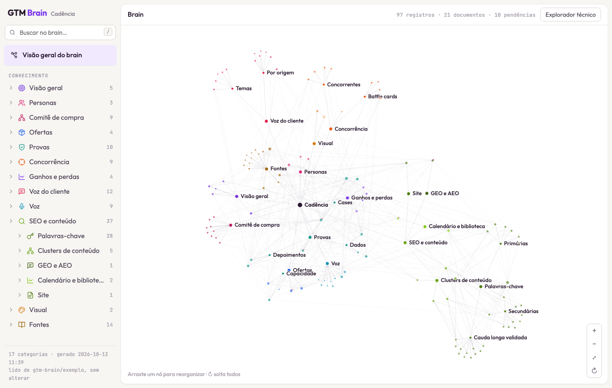
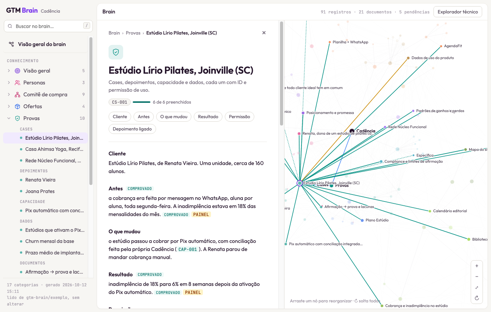

# GTM Brain

O cérebro de go-to-market da sua marca, em markdown.

Você descreve a marca em 11 camadas de arquivos simples: quem compra, como a marca fala, o que vende, contra quem, com que prova, como é achada e o plano. Qualquer agente de IA lê esses arquivos e passa a escrever como a sua marca, e não de um jeito genérico.

O **GTM Brain** lê os mesmos arquivos como um banco de dados e mostra a marca do jeito que um time de marketing pensa nela:

- **Fichas por tipo:** personas, ofertas, provas, concorrentes, negócios ganhos e perdidos, palavras-chave, atributos de voz. Cada uma com seus campos e um medidor de "N de M preenchidos".
- **Ligações:** qual prova sustenta qual oferta, de que fonte veio cada afirmação, o que está pendente e o que se contradiz.
- **Grafo:** marca → categorias → registros, com nós que você arrasta e reorganiza.
- **Edição humano + IA:** cada ficha abre o arquivo de origem num editor colaborativo. Agentes propõem mudanças como sugestões, você aceita ou recusa, e o arquivo só muda quando você salva. O que a IA escreveu fica marcado.

Os arquivos continuam sendo a fonte de verdade: markdown no seu repositório, versionado no git, legível sem o GTM Brain.





## O que tem aqui

| Pasta | O que é |
| --- | --- |
| [`marca/`](marca/) | O template em branco: as 11 camadas para você preencher |
| [`exemplo/`](exemplo/) | A **Cadência**, uma startup fictícia com as camadas preenchidas, para ver o GTM Brain funcionando |
| [`brain/`](brain/) | O app: leitura dos arquivos, fichas, grafo, servidor e editor colaborativo |
| [`skills/`](skills/) | Skills para um agente de IA preencher a marca com você |
| [`docs/`](docs/) | Convenções que o GTM Brain entende |

## As 11 camadas

| Camada | Arquivos principais | Para quê |
| --- | --- | --- |
| `01-icp` | ICP, comitê de compra, voz do cliente | Quem compra, por quê, com que palavras |
| `02-voz` | Voz, terminologia, compliance | Como a marca soa e o que ela não pode dizer |
| `03-visual` | Identidade visual, imagens, prompts de imagem | Como a marca se parece |
| `04-design-system` | Design, tokens, specs | Componentes e regras para quem constrói telas |
| `05-oferta` | Oferta, concorrência, ganhos e perdas | O que a marca vende, contra quem e por que ganha |
| `06-seo` | Palavras-chave, clusters, GEO e AEO | Como a marca é achada, inclusive por IAs |
| `07-site` | Mapa do site, dados estruturados | A arquitetura do site |
| `08-conteudo` | Provas, calendário, biblioteca | Cases e dados com permissão de uso, e o que publicar |
| `09-dados` | Medição, plano de medição, destaques | O que medir e o que funcionou |
| `10-cerebro` | Cérebro da marca, playbooks, prompts, modelos | O system prompt que junta tudo para os agentes |
| `11-plano` | Plano de uma página, conta do cliente | O plano de marketing e a conta que o sustenta |

Comece por `01-icp/ICP.md`, `02-voz/VOZ.md` e `05-oferta/OFERTA.md`. Com essas três, um agente já escreve melhor.

## Começar

Requisitos: Node 20 ou mais novo e git.

**1. Ver o GTM Brain com o exemplo**

```sh
cd brain
npm run build -- --marca ../exemplo
open out/gtm-brain.html
```

Gera um HTML único, que abre direto no navegador, sem servidor.

**2. Preencher a sua marca**

Edite os arquivos em `marca/` (ou copie a pasta para o repositório da sua marca). Depois:

```sh
npm run build -- --marca ../marca
```

**3. Editar com pessoas e agentes**

```sh
npm run setup:proof           # uma vez: baixa e prepara o editor colaborativo
npm run dev -- --marca ../marca --write
```

Abra http://127.0.0.1:3348. Em qualquer ficha, **Editar com IA** abre o arquivo no editor. **Chamar agente** copia as instruções para colar no seu agente (Claude Code, Codex, ChatGPT…): ele lê o documento e propõe mudanças como sugestões. **Salvar no arquivo** grava só as linhas que mudaram. Com `--commit`, cada salvamento vira um commit.

Sem `--write`, o servidor fica em modo leitura: dá para editar e ver as mudanças, mas nada vai para o disco.

**4. Preencher com um agente**

As skills de [`skills/`](skills/) conduzem o preenchimento com você. O agente lê as fontes que você indicar (site, transcrições de calls, CRM, avaliações, notas), pergunta só o que elas não respondem, poucas perguntas por vez e cada uma com uma resposta recomendada, e escreve nos arquivos com selo e fonte em cada afirmação, sem inventar número. O que ele não souber fica marcado como pendente.

No Claude Code, abra o repositório e peça "preencher a marca", ou instale as skills como plugin para usar em qualquer pasta:

```
/plugin marketplace add alexandrelt44/gtm-brain
/plugin install gtm-brain@gtm-brain
```

Em outros agentes (Codex, Cursor…), aponte para [`AGENTS.md`](AGENTS.md).

Para ver o que falta e qual skill usar em cada arquivo:

```sh
npm run lacunas -- --marca ../marca
```

**5. Usar com qualquer agente de IA**

Cole `10-cerebro/CEREBRO.md` como system prompt e siga a ordem de carga que ele indica. Com o servidor rodando, `GET /api/brain` devolve todas as fichas em JSON.

## Convenções

O GTM Brain funciona com o template como ele vem. Algumas marcações deixam a leitura mais rica:

- **Selos de evidência:** `[COMPROVADO]`, `[HIPÓTESE]`, `[OBSERVADO]`, `[PROPOSTA]`
- **IDs de prova:** `CS-001` (case), `T-001` (depoimento), `D-001` (dado), `CAP-001` (capacidade)
- **Fonte por afirmação:** `` `[ENTREVISTAS §2]` ``, com a fonte definida uma vez no arquivo
- **Pendência e contradição explícitas:** `[PENDENTE: …]`, `[CONTRADIZ: …]`

Detalhes em [`docs/convencoes.md`](docs/convencoes.md).

## Licença

[MIT](LICENSE). Avisos de terceiros em [`AVISOS-DE-TERCEIROS.md`](AVISOS-DE-TERCEIROS.md).
